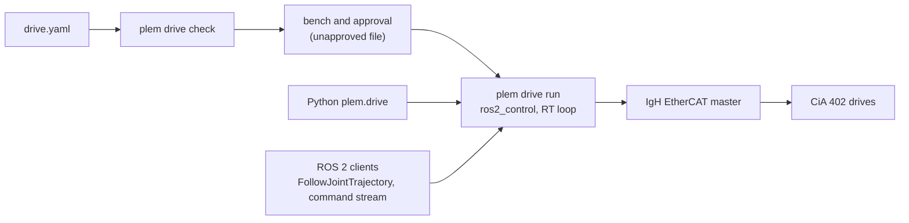

# PLEM drive layer

**Run EtherCAT servo drives from an NVIDIA Jetson: one YAML file per bus, a real-time loop under ros2_control, and a
Python client.**

[](LICENSE)
[](docs/install.md#supported-platform)
[](docs/install.md#supported-platform)

The PLEM drive layer runs CiA 402 servo drives over EtherCAT (CoE) from a Jetson AGX Orin with a PREEMPT_RT kernel,
the IgH EtherCAT master (EtherLab's open-source master) and ROS 2 Jazzy. You describe a bus and its drives in one YAML
file, and `plem drive run` runs that bus under ros2_control on a real-time loop. You write no C++, and you move the
axes from Python or from any ROS 2 client. It is the open foundation of PLEM, a robot control platform for Jetson
([below](#part-of-plem)).

[](docs/media/a6b-pair-demo.mp4)

The two-axis example on its bench (35 s, no sound). Partway through, the jaw coupling is pulled apart and pushed back
together by hand while both outputs turn. That is a deliberate test on this bench, not a step of any procedure here.

## Quick look

A drive model file declares a bus: its drives, their mapping, units and limits. This excerpt is the axis block of the
two-axis example, [`plem_drive/examples/a6b_pair/drive.yaml`](plem_drive/examples/a6b_pair/drive.yaml). Its
comments point to the example's own README and to the schema, [`docs/cia402-drive-model.md`](docs/cia402-drive-model.md):

```yaml
    axes:
      - name: [axis0, axis1]
        channel: 1
        mode: csp
        mode_display_timing: pre_enable           # 0x6061 read 8 at rest on these drives (schema §4.2a)
        factors:
          gear_ratio: 21.0                 # the gearhead: motor turns per output turn
          encoder_resolution: 8388608      # 23-bit; assumes the factory 1:1 electronic gear
          # Torque in 0.1 % of the motor's rated torque, 3.18 N·m (0x6076 in mN·m ÷ 1000).
          torque: { unit: rated_per_mille, motor_rated_torque_nm: 3.18 }
          velocity: { velocity_factor: 1.0 }
        flip: [false, false]
        zero_offset_count: [0, 0]          # 0x6064 counts (motor) at the position you call 0 — measure yours
        # At the output. Narrow the position limits for your zero, and keep more
        # than your measured stop distance to each (README.md).
        limits:
          position: { min_rad: -59.5, max_rad: 59.5 }
          # 80 % of the motor's 5000 r/min ÷ 21. A measured speed above it is a
          # protective stop: plan moves below it, with room for overshoot.
          velocity_rad_s: 19.9
          acceleration_rad_s2: 95.0          # a requested stop's deceleration, under the drive's 6085h (152 at the output)
```

Check the file, then run it. For a file not yet approved, `run`, started from a terminal, offers to run the bench (you
stand at the drives) and records the approval in the file. The section numbers are those of
[`docs/getting-started.md`](docs/getting-started.md):

```bash
mkdir -p "$HOME/drives" && cp "$(ros2 pkg prefix --share plem_drive)/examples/example_drive.yaml" "$HOME/drives/my_drive.yaml"   # copy an example (section 1)
# fill in your drive's values (section 2)
plem drive check "$HOME/drives/my_drive.yaml"   # check the file (section 3)
plem drive run "$HOME/drives/my_drive.yaml"     # bench it once (section 8), then run the bus (section 4)
```

Move the axes from Python:

```python
from plem.drive import Bus, SCurve

with Bus("my_drive") as bus:              # the file's bus.name; leaving the block stops the axes
    print(bus.axes, bus.positions)        # axis names; positions in rad
    bus.reset()                            # clear a fault latched when the bus last stopped
    bus.release()                          # brakes off; the axes hold where they are
    start = bus.positions
    bus.move_to({name: start[name] + 0.5 for name in bus.axes},
                velocity_scale=0.2, acceleration_scale=0.2)   # returns on arrival
    bus.move_to(start, profile=SCurve())
```

## What you get



- One YAML file per bus holds its drives' PDO mapping, startup SDOs, unit factors, direction, zero and limits.
  `plem drive check` refuses a bad file before any drive is touched and names the key and the fix; rules that need the
  bus (cycle, distributed clocks) are judged when `run` attaches it.
- Motion is enabled only for an approved file, or in a bench run (`--unapproved`, only when you are at the drives). The
  bench measures the file at the drives and records the approval in the file; editing a value or replacing a drive
  voids it, and every start compares the live drives with the record. Approval checks that the file, its bench
  evidence and the drives agree, not that the measurements are true.
- Each axis runs cyclic synchronous position, velocity or torque (`csp`, `csv`, `cst`), and one bus may mix them, up
  to eight axes. Position axes take trajectories through the joint trajectory controller (`Bus.move_to`, or any
  `FollowJointTrajectory` client). Velocity and torque axes take a command stream.
- The bus takes a protective stop (the standard CiA 402 disable, then the brakes) when commands stop arriving (50 ms
  after the last one, about 100 ms on a command stream) while it is released, or at any time on a bus with a torque
  axis, or when a position or velocity command passes a limit. The drive's own stop settings decide how the axis
  slows. On a bus without a torque axis, `Bus.stop()` and Ctrl-C first ramp the axes to rest. A killed process is left
  to the drive's own watchdog ([`docs/getting-started.md`](docs/getting-started.md), section 6).
- `plem drive run --monitor` prints loop timing, overruns and the bus state once a second, and `--plot` streams every
  cycle into PlotJuggler. The bus publishes `joint_states`, status, RT events and a raw per-cycle stream on ROS 2.
  Loop timing measured on JetPack 7.2.1 with a 1 kHz bus and an Intel I210 card on IgH's native driver, with figures, is in
  [`docs/benchmark/README.md`](docs/benchmark/README.md).
- Each network port can run its own IgH master, so with extra network cards one Jetson can run several buses side by
  side (not yet run on hardware), each one `plem drive run --master N` on its own port and isolated CPU ([`docs/install.md`](docs/install.md),
  section 2).
- The setup wizard, [`setup/rt/setup.sh`](setup/rt/), installs the RT kernel, isolates a CPU, installs the IgH master
  and verifies the setup, with an optional jitter load test. The `add-drive` agent skill lets a coding agent draft a drive
  model file from your drive's documents, citing the source of each value; the bench stays yours
  ([`docs/getting-started.md`](docs/getting-started.md), section 1).

## Part of PLEM

PLEM is a robot control platform for NVIDIA Jetson. This repository holds the drive layer it is built on: the
real-time core and the EtherCAT drive control, with one drive model (a Panasonic A6B pair) as the worked example. The
rest of the platform is not published here; its documentation and release notes are at
[www.wimcorp.co.kr/plem](https://www.wimcorp.co.kr/plem). PLEM is made by WIM:
[www.wimcorp.co.kr](https://www.wimcorp.co.kr/en).

## Where to start

1. [`docs/install.md`](docs/install.md): prepare the Jetson (JetPack 7.2.1, RT kernel, IgH master, ROS 2 Jazzy) and
   build the drive software from source.
2. Then one of:
   - Two Panasonic A6B drives: the example's guide,
     [`plem_drive/examples/a6b_pair/README.md`](plem_drive/examples/a6b_pair/README.md), from checking each drive
     to the demo.
   - Any other CiA 402 drive: [`docs/getting-started.md`](docs/getting-started.md), which takes you through copying
     the example file, filling in your drive's values, checking the file, the bench, running the bus, moving an axis,
     stopping it and recovering.
3. [`docs/cia402-drive-model.md`](docs/cia402-drive-model.md): the reference for every key in the file.

## Status

The supported platform is a Jetson AGX Orin Developer Kit with JetPack 7.2.1 (Ubuntu 24.04), ROS 2 Jazzy and IgH
1.6.13; [`docs/install.md`](docs/install.md#supported-platform) lists what is not supported. On that platform, the
bench, `plem drive run` and the example's demo have run with two A6B drives. Both the built-in port and the Intel I210
native driver have run. For 1 kHz, use an Intel I210 card: three five-minute runs had no overrun or working-counter
error ([benchmark](docs/benchmark/README.md)). The devkit's built-in port is for evaluation and does not guarantee 1 kHz without lost frames
([`docs/install.md`](docs/install.md), section 0).

Not run yet: the coupled pair turning together under torque, `--rt-cpu`, and two `plem drive run` buses on one Jetson.
[`docs/hardware-evidence.md`](docs/hardware-evidence.md) has every hardware session, what was observed and what is
still not known, and the drive model file schema marks rule by rule what was verified on hardware.

## Repository layout

| Path | What it is |
|---|---|
| `plem_core` | Timing, logging, RT thread configuration, the lock-free queues the RT loop reports through, SHA-256 (libsodium) and the shared RT data block (`SharedJointData`) |
| `plem_fieldbus` | The EtherCAT bus (IgH master), the CiA 402 state machine, brakes, protective stop, and PDO mapping checks |
| `plem_drive` | The `plem drive` command (`check`, `run`; installed as `plem-drive`), the Python client `plem.drive`, the ros2_control hardware interface and stream controller plugin, the bench, the monitor, `rt_raw_relay`, examples (with the `a6b_pair` PlotJuggler layout) and the `add-drive` agent skill. Under them sits the drive library without ROS: the drive model file loader and value checks, the drive host, and `drive_model_tool` |
| `plem_rt_msgs` | ROS 2 interfaces every PLEM RT host shares: the RT event and raw cycle messages and the control command service |
| `plem_drive_msgs` | ROS 2 messages specific to the drive bus: its facts (`DriveInfo`) and status (`DriveStatus`) |
| [`docs/install.md`](docs/install.md) | Setting up a Jetson AGX Orin: supported platform, choosing the EtherCAT port, running the setup wizard, real-time permission, checking the master, building the drive software from source |
| [`docs/getting-started.md`](docs/getting-started.md) | A drive model file, `plem drive run`, moving and streaming, stopping, bench and approval, monitoring, a two-axis example |
| [`docs/cia402-drive-model.md`](docs/cia402-drive-model.md) | The drive model file schema: every key, and where each rule is checked |
| [`docs/internals/drive-model-contracts.md`](docs/internals/drive-model-contracts.md) | For contributors: how the loader maps the file to its value spec, the loader contract, how the approval digests are computed, and which function checks each rule |
| [`docs/api-scope.md`](docs/api-scope.md) | Public surface that serves a separate, non-public stack, and the headers installed only for tests |
| [`docs/benchmark/README.md`](docs/benchmark/README.md) | Measured timing of a 1 kHz bus on a Jetson AGX Orin: wake latency, cycle work, errors, DC deviation, with figures |
| [`tools/plem`](tools/plem) | The `plem` command dispatcher (`plem drive …` runs `plem-drive …`; [`docs/install.md`](docs/install.md), section 6) |
| [`tools/bench_report.py`](tools/bench_report.py) | Turns a recorded `rt_raw` bag into the timing figures of [`docs/benchmark/README.md`](docs/benchmark/README.md) |
| [`setup/rt/`](setup/rt/) | The Jetson setup wizard (`setup.sh`): RT kernel, CPU isolation, IgH EtherCAT master, verification and a jitter load test, with its own `README.md` |
| `CONTRIBUTING.md`, `SECURITY.md`, `CHANGELOG.md` | How issues and pull requests are handled, where to report a security problem, and the changes by release |

Some public headers and message fields serve the unpublished robot stack, and some installed headers are test support
only. [`docs/api-scope.md`](docs/api-scope.md) lists both.

<details><summary>Header namespaces (C++)</summary>

Each package's include folder is its namespace: `<plem/drive/...>` declares `plem::drive`. A subfolder either adds a
level (`plem/fieldbus/ethercat/` is `plem::fieldbus::ethercat`) or only groups files (`plem/core/timing/` stays
`plem::core`). Exceptions:

- The vendored queue under `plem/core/third_party/rigtorp/` keeps its namespace `rigtorp`.
- `plem/core/monitoring.hpp` declares `plem::core::monitoring`.
- `plem/drive/models/drive_model_spec.hpp` also declares `plem::drive::kMaxAxes`.
- Apart from `detail` namespaces and test-peer declarations, two headers nest a namespace of their own:
  `plem::core::threading::seqlock` in `plem/core/threading/seqlock.hpp` and `plem::drive::ros::rt_event_pin` in
  `plem/drive/ros/rt_event.hpp`.

Each package installs its headers to `<prefix>/include/<package>/`. Use them through the package's CMake target
(`find_package` + `target_link_libraries`), not a hand-written include path.

</details>

## Device reporting

The setup wizard asks once whether to share device data with WIM. If you answer Yes, a timer (about every two hours) and each
`plem drive run` report the device's hardware, software versions, health and EtherCAT session statistics. Nothing is
sent if you answer No, or on a device where nobody answered. Turn it off any time with `sudo plem-fleet off`.
[`docs/telemetry.md`](docs/telemetry.md) lists what is sent, what is not, and how long it is kept.

## Contributing and security

Issues are welcome, and pull requests are taken as proposals: see [`CONTRIBUTING.md`](CONTRIBUTING.md) for what to
include and how a change reaches this repository. Report security problems through [`SECURITY.md`](SECURITY.md), not
as an issue. [`CHANGELOG.md`](CHANGELOG.md) lists the changes by release.

## License

Apache License 2.0. The text is in `LICENSE`, at the root, in each package and in [`setup/rt/`](setup/rt/). One file
keeps the license written in its own header instead:
[`plem_core/include/plem/core/third_party/rigtorp/SPSCQueue.h`](plem_core/include/plem/core/third_party/rigtorp/SPSCQueue.h)
(MIT, Erik Rigtorp). The attribution notices are in `NOTICE`.
