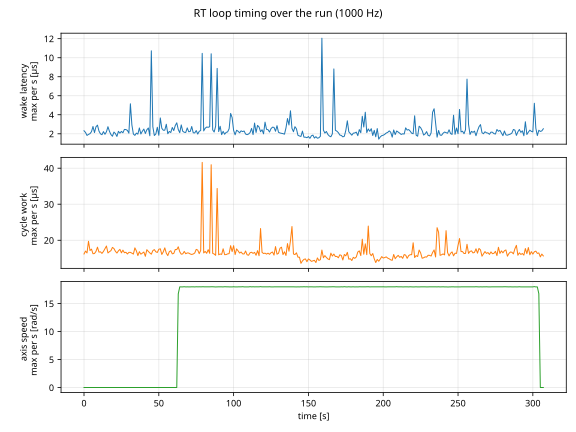
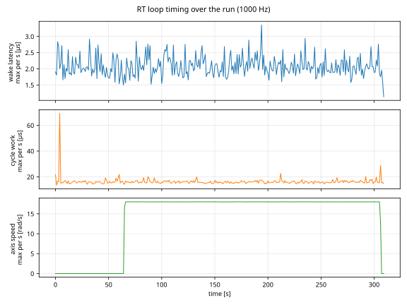
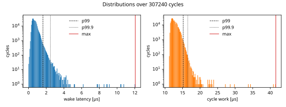
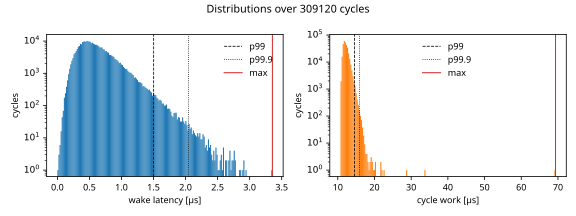
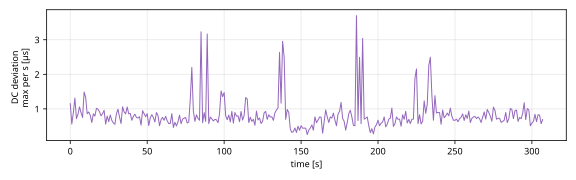
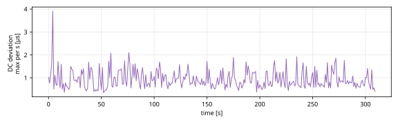

# Drive bus timing on a Jetson AGX Orin

A Jetson AGX Orin on JetPack 7.2.1 with ROS 2 Jazzy and an Intel I210 card on IgH's native driver (`ec_igb`, Case 2)
ran a 1 kHz EtherCAT bus of two servo drives for three five-minute runs, the third with every CPU but the loop's kept busy. Every cycle was recorded, and none overran or
came back with a wrong working counter.
Measured against its deadline, the loop woke in 99 % of cycles no more than 1.7 µs later than in its least-late cycle,
and 12.0 µs later in the worst one (a relative figure: see "What each number is"). Cycle work averaged 12 to 13 µs of
the 1 ms period. Under the added load the wake latency and the mean cycle work were no higher; the DC deviation p99
rose from 0.9 to 1.0 µs, and the cycle that released the brakes took 69.3 µs against about 20 µs in runs 1 and 2.

These are measurements of one setup, not a specification. "What this does not show" below lists what they leave open.

## Results: Intel I210 (Case 2)

| | Run 1 | Run 2 | Run 3, added load |
| --- | --- | --- | --- |
| Duration | 307 s | 307 s | 309 s |
| Cycles recorded | 306,920 of 306,920 | 307,240 of 307,240 | 309,120 of 309,120 |
| Overruns | 0 | 0 | 0 |
| Working-counter errors | 0 | 0 | 0 |
| Wake latency, p99 / p99.9 / max | 1.7 / 2.5 / 6.1 µs | 1.6 / 2.5 / 12.0 µs | 1.5 / 2.0 / 3.4 µs |
| Cycle work, mean / p99 / max | 12.8 / 15.3 / 25.3 µs | 12.7 / 15.2 / 41.6 µs | 12.2 / 14.5 / 69.3 µs |
| DC deviation, p99 / max | 0.9 / 3.2 µs | 0.9 / 3.7 µs | 1.0 / 3.9 µs |

The p99 and p99.9 values were close in all three runs. Under load the wake latency and cycle work p99 were slightly
lower, which was not explained (the CPU clock was not recorded for run 3) and should not be read as load improving the
timing; the DC deviation p99 was slightly higher. The maxima varied (wake latency 6.1, 12.0 and 3.4 µs; cycle work 25.3,
41.6 and 69.3 µs): a maximum is the single worst cycle of a run, and a longer run or one under load can show a larger
one.

Run 3's 69.3 µs cycle was the one in which the brakes were released (4.8 s in); that cycle took 22.1 and 19.7 µs in
runs 1 and 2, and the brake-engage cycle at the end took 28.9 µs against 16.3 and 15.4 µs. Run 3's DC deviation maximum,
3.9 µs, came 3 ms after the release; after the first 10 s its maximum was 2.1 µs. Its largest cycle work while moving was
22.6 µs. What made the brake cycles slower under load was not measured.

In run 3 the motion script, a Python client on the loaded CPUs, completed 245 moves in its 240 s against 253 in runs 1
and 2: the moves reached the same peak speed and took about as long, but the pauses between them were longer (median
97 ms against 58 and 59 ms, counting an axis as stopped below 0.01 rad/s). The loop's figures while moving were no worse.

Moving the axes made no consistent difference. The wake latency p99 was 1.5 µs before the first move and 1.7 µs while
moving in run 2, 1.8 and 1.6 µs in run 1, and 1.5 and 1.5 µs in run 3.

`run1-summary.json`, `run2-summary.json` and `run3-summary.json` hold every figure of each run, means and both phases
included.

## A cross-check on the built-in RJ45 port (Case 1)

On JetPack 7.2.1 with ROS 2 Jazzy, one run of the same five-minute motion went over the devkit's built-in RJ45 port
(Linux driver `nvethernet`) with IgH's `generic` driver (2026-10-14; gearhead outputs free, CPU governor `performance`). Over the 304 s from 4 s after
recording began (before that the drives were still reaching operation) to the end of the motion, no cycle overran, the
wake latency p99 was 1.0 µs (max 3.6 µs), and cycle work averaged 9.4 µs with a p99 of 10.8 µs. The run also had
working-counter errors: one during the motion, and five in the following six minutes while the bus stayed up with the
axes stopped. The port, driver, CPU governor and coupling differ from runs 1 to 3, so these figures are not a comparison
with them. The built-in port is for evaluation and does not guarantee 1 kHz without lost frames
([`docs/install.md`](../install.md#0-choose-the-ethercat-port)).

## Figures

Run 2 ran without added load, run 3 with it. `bench_report.py` scales each figure to its own data, so compare the axis
values, not the heights.













In run 2 the three largest wake latencies and cycle work times came in the same seconds (79, 85 and 89 s), together
with DC deviation peaks. Cycle work and DC deviation peaked again from 186 to 190 s. In run 3 the cycle work and DC
deviation peaks sit at the brake release in second 4, and cycle work rises again at the brake engage in second 306; its
largest wake latency, 3.4 µs, came in second 194. What caused these peaks was not measured.

## What each number is

| Number | What it is |
| --- | --- |
| Wake latency | How much later, measured against its deadline, a cycle woke than the run's least-late cycle. The loop sleeps to absolute deadlines (start + n × period), so each cycle's wake time minus its deadline is known up to one constant; subtracting the smallest one leaves the spread. It is not the absolute delay after the timer expired. |
| Cycle work | From the wake to the end of sending the frame: receive, check the working counter, process the axes, write, send. Measured on the loop's own clock. The thread also spends a little time after sending and in the sleep call, so its total CPU time is somewhat higher. |
| Overruns | Cycles whose work took longer than the period. |
| Working-counter errors | Cycles whose returned frame did not carry the expected working counter. |
| DC deviation | From IgH's `ecrt_master_sync_monitor_process()`: an upper estimate of the largest difference between a drive's clock and the reference clock (register 0x092C), read every cycle. |

## Setup

| | |
| --- | --- |
| Board | Jetson AGX Orin, JetPack 7.2.1 (L4T R39.2.1), power mode MAXN, CPU governor `schedutil` (2.2 GHz read before runs 1 and 2) |
| Kernel | 6.8.x-rt-tegra (PREEMPT_RT), `isolcpus=managed_irq,domain,11`, interrupts on CPUs 0 to 10 |
| Clock | nvpps PTP-TSC lock disabled (`ptp_tsc_sync_dis` in the device tree). With it on, the host clock is slewed and the drives' DC drift follows; `plem drive run` warns about it ([`docs/getting-started.md`](../getting-started.md), section 4) |
| Device setup | An earlier version of the setup wizard ([`setup/rt/setup.sh`](../../setup/rt/setup.sh), menus 1 to 3). The services its `--baseline` option turns off ([`setup/rt/README.md`](../../setup/rt/README.md)) were off in all three runs |
| RT loop | One thread on the isolated CPU 11, SCHED_FIFO priority 98, sleeping to absolute deadlines (`clock_nanosleep` with `TIMER_ABSTIME`) |
| EtherCAT master | IgH EtherCAT master 1.6.13 with its native Intel I210 driver (`ec_igb`) |
| Bus | Two Panasonic MINAS A6B drives (MDDLN55BE), one `csp` axis each; 1 ms cycle; DC SYNC0 with a 300 µs shift; 68 bytes of process data in one LRW datagram |
| Software | A PLEM development build before the first public release (2026-10-06), ROS 2 Jazzy, `plem drive run` with the two-axis example of [`docs/getting-started.md`](../getting-started.md) (section 10) |
| Motion | About 60 s before the first move (bus reset and brake release included), then about 240 s of mirrored moves back and forth (±5 rad at 0.9 × the velocity and acceleration limits, about 17.9 rad/s), with the two gearhead outputs coupled |
| Background | Runs 1 and 2: no load added. Other programs were running: about 7 % of all CPU time was busy (user and system), load average 6.5 to 9.2 |
| Added load (run 3) | A busy loop pinned to each of CPUs 0 to 10 (every CPU but the loop's), and a loop writing zeros into a 4 MiB buffer (`dd if=/dev/zero of=/dev/null bs=4M`) on CPUs 0 and 5, started about 3 s after the recorder and running to the end: 92 % of all CPU time was busy over the motion, 1-minute load average 7.7 to 24.6. The loop's CPU 11 was left alone. Same build, drive configuration and rig as runs 1 and 2, on 2026-10-07 |

## What this does not show

- Other kinds of load: interrupts, network or disk traffic, GPU work, heavy memory or shared-cache traffic, or load on
  the loop's own CPU. Run 3 kept the other CPUs busy with in-core loops; only two of them wrote to memory.
- When the frame arrives at the drives (frame jitter at the slaves): the loop does not record it.
- More drives, other drives, or other cycle times.
- The absolute wake delay, and the RT thread's exact CPU time.
- Worst cases over long runs: each run is five minutes.

## Measure your own bus

`tools/bench_report.py` is optional: `plem drive` does not need it. It needs ROS 2 and `plem_rt_msgs` (sourced as
for `plem drive run`), and numpy and matplotlib (`sudo apt install python3-numpy python3-matplotlib`).

1. While the bus runs, record its `rt_raw` in a second terminal, and stop the recorder with Ctrl-C when the run is
   done. Record one run per bag: a bag in which the bus restarted is refused.

   ```bash
   ros2 bag record -o run /<bus.name>/rt_raw
   ```

2. Turn the bag into figures:

   ```bash
   python3 tools/bench_report.py run report
   ```

`report/` then holds `summary.json` (every figure of the run), `timeline.svg`, `distributions.svg`, `dc-deviation.svg`
and `cycles.csv.gz` (one row per cycle). The report refuses a run in which the loop overran or fell a period behind,
because the wake latency is measured against deadlines that such a run moves.

To draw the figures on a computer without ROS, split the two steps: `export` on the Jetson writes the cycles file,
`report` turns it into figures and needs only numpy and matplotlib.

```bash
python3 tools/bench_report.py export run cycles.csv.gz     # on the Jetson
python3 tools/bench_report.py report cycles.csv.gz report  # anywhere
```
